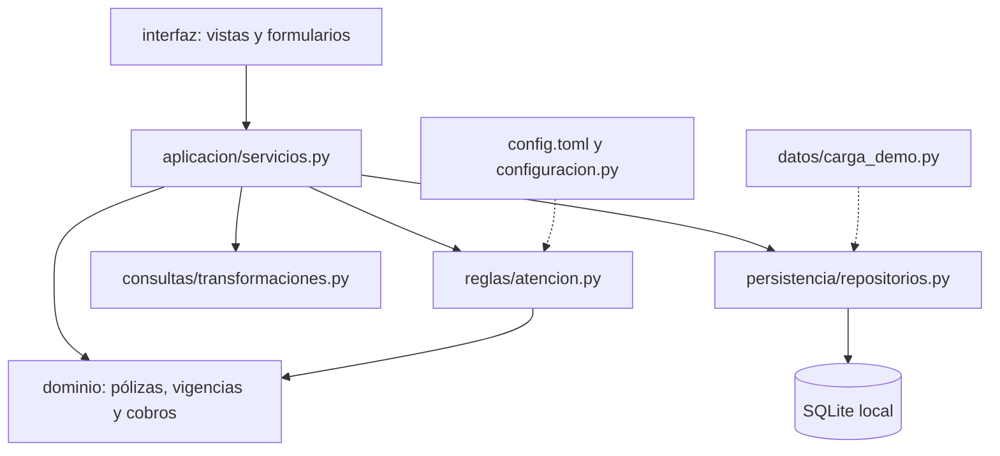

# Urdiales · Esqueleto del proyecto

Estructura inicial para desarrollar el sistema de pólizas con Django y SQLite, siguiendo los módulos del diagrama proporcionado.

**Los archivos de negocio, formularios, vistas, plantillas, estilos y pruebas están vacíos.** Solo los archivos de arranque y configuración conservan el código mínimo de Django. No hay funcionalidades implementadas, datos de demostración ni tablas de negocio.

## Archivos y responsabilidades previstas

Las rutas de la tabla se encuentran dentro de `urdiales_polizas/`, salvo las que indican «raíz».

| Archivo o carpeta | Responsabilidad al implementarlo |
| --- | --- |
| `manage.py` (raíz) | Ejecutar comandos de Django |
| `requirements.txt` (raíz) | Dependencias del proyecto; por ahora solo Django |
| `config.toml` (raíz) | Reservar la anticipación de 30 días; todavía no se lee |
| `sitio/settings.py` | Configuración mínima de Django, plantillas y SQLite |
| `sitio/urls.py` | Conectar las rutas del proyecto con las de la interfaz |
| `sitio/wsgi.py` | Punto de entrada del servidor |
| `interfaz/apps.py` | Registrar la aplicación Django |
| `interfaz/urls.py` | Reservar las rutas de las pantallas; lista vacía |
| `interfaz/views.py` | Atender solicitudes y llamar a los servicios |
| `interfaz/forms.py` | Definir los formularios de captura y filtros |
| `interfaz/templates/interfaz/` | Plantillas vacías de cartera, histórico, asegurados, aseguradoras y pólizas |
| `interfaz/static/interfaz/` | Archivos vacíos `sitio.css` y `sitio.js` |
| `interfaz/migrations/` | Reservar futuras versiones del esquema; solo `__init__.py` |
| `aplicacion/servicios.py` | Coordinar registros, consultas, renovaciones, cobros y cancelaciones |
| `dominio/clientes.py` | Definir asegurados, contactos y sus medios |
| `dominio/polizas.py` | Definir pólizas, aseguradoras, vigencias y vehículos |
| `dominio/cobros.py` | Definir cobros y estados |
| `reglas/atencion.py` | Consultar reglas de fechas y anticipación |
| `consultas/transformaciones.py` | Clasificar, filtrar y ordenar resultados |
| `persistencia/repositorios.py` | Consultar y guardar con SQL parametrizado |
| `persistencia/esquema.sql` | Reservar tablas, relaciones y restricciones; archivo vacío |
| `datos/carga_demo.py` | Reservar la carga y limpieza de datos ficticios |
| `configuracion.py` | Reservar la lectura de `config.toml` |
| `tests/` (raíz) | Reservar las futuras pruebas de servicios y reglas |

Cada paquete incluye su `__init__.py` vacío. Las plantillas identifican las pantallas previstas, pero no contienen HTML.

## Conexiones previstas

Este esquema es la guía para implementar las dependencias. Los módulos vacíos todavía no se llaman entre sí.



La conexión real inicial es `manage.py` → `sitio/settings.py` y `sitio/urls.py` → `interfaz/urls.py`. El resto se implementará dentro de las carpetas indicadas, sin añadir otra aplicación web o una API independiente.

## Comprobar la estructura

Requiere Python 3.11 o posterior. Desde la raíz:

```bash
python -m venv .venv
```

En Windows:

```powershell
.venv\Scripts\python -m pip install -r requirements.txt
.venv\Scripts\python manage.py check
```

En Linux/macOS, sustituye `.venv\Scripts\python` por `.venv/bin/python`.

`check` comprueba la configuración de Django; no ejecuta pruebas funcionales. Puedes iniciar el servidor con `python manage.py runserver` usando el Python del entorno, pero todavía no hay rutas de pantallas: abrir `/` devolverá 404. No hace falta ejecutar migraciones para revisar este esqueleto.
