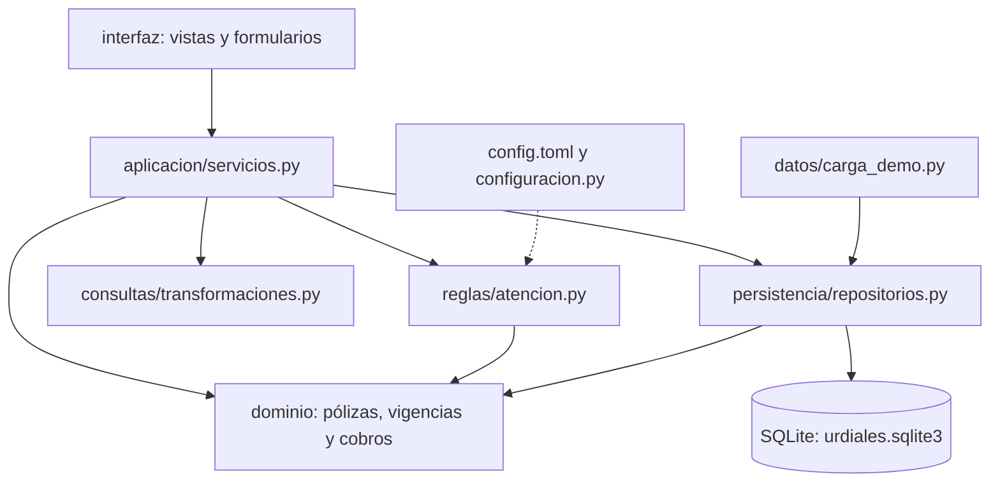

# Urdiales Asesores · Sistema de renovación y cobranza de pólizas

Aplicación en Django y SQLite para el despacho **Urdiales Asesores**. Centraliza los asegurados y sus pólizas de **autos y daños**, y ayuda a identificar qué renovaciones y cobranzas requieren atención. Los datos iniciales se cargan una vez desde el Excel del despacho exportado a CSV.

Proyecto integrador de Paradigmas de Programación (Alfa Consultora).

## Requisitos

- **Python 3.11 o posterior.** Se usa `tomllib` para leer `config.toml`.
- **Git.**

## Instalación y arranque (5 pasos)

Los comandos se escriben en una terminal (cmd, PowerShell o la terminal de VS Code), desde la carpeta del proyecto.

**1. Descargar el proyecto**
```bash
git clone https://github.com/Nano277353/Proyecto-Poliza.git
cd Proyecto-Poliza
```

**2. Crear el entorno e instalar dependencias**
```bash
python -m venv .venv
.venv\Scripts\activate          # Windows
source .venv/bin/activate       # Linux / macOS
pip install -r requirements.txt
```

**3. Crear la base de datos**
```bash
python manage.py migrate
```
Crea `urdiales.sqlite3` con las tablas de `persistencia/esquema.sql`.

**4. Cargar los datos de ejemplo (300 filas ficticias)**
```bash
python manage.py cargar_demo --indicadores
```
Debe decir `Filas válidas: 300 · Filas inválidas: 0` y mostrar tres indicadores.

**5. Probar y abrir la aplicación**
```bash
python manage.py test
python manage.py runserver
```
`test` debe terminar en `OK`. Con `runserver` abierto, entra a <http://127.0.0.1:8000/>. Mientras la interfaz no tenga pantallas, Django muestra su página de bienvenida (un cohete); las pruebas confirman que lo demás funciona. Para cerrar el servidor: `Ctrl + C`.

La próxima vez solo se activa el entorno (paso 2, segunda o tercera línea) y se corre `runserver`.

## Cargar el Excel del despacho

1. En Excel: **Archivo → Guardar como → CSV UTF-8**. También se acepta el CSV normal de Excel en español, separado por punto y coma.
2. Con la base vacía:
   ```bash
   python manage.py cargar_demo --archivo ruta\al\archivo.csv
   ```

La carga revisa cada fila por separado. Una fila inválida **no detiene** la carga: se reporta con su número y el motivo, y las demás se guardan. Si faltan columnas o la base ya tiene datos, no se modifica nada.

**Columnas esperadas.** Se aceptan con o sin acentos y con nombres parecidos (por ejemplo, «Compañía» o «No. de póliza»). Las columnas extra se ignoran con un aviso.

| Columna | Contenido |
| --- | --- |
| Asegurado | Nombre. También se acepta `Nombre (Compañía)` |
| Compañía de seguro | Una de las de `config.toml` → `aseguradoras` |
| Año de renovación | Año en que inicia la vigencia |
| Número de póliza | Letras y números. Varias filas de autos con el mismo número forman una **flotilla** |
| Ene … Dic | En cada mes con cobro, el **día** y sus marcas: `✓` pagado · `C` cobranza manual · `R` renovación por cotizar · `*` mes de la renovación anual |
| Forma de pago | Mensual, trimestral, semestral o anual |
| Descripción del auto, Modelo, Serie | Solo autos. La serie es obligatoria |
| Póliza de daños | Bien asegurado (solo daños) |
| Teléfono, Correo | Opcionales |
| Recomendó | Nombre y celular de quien recomendó (`Nombre / 81…`). Opcional |
| Correo de quien recomendó | Opcional |
| Estatus | En vigor o Cancelada |

El tipo de cobro se deduce de las marcas: si la fila tiene alguna `C`, la cobranza es manual; si no tiene ninguna, la póliza está domiciliada (cargo automático). Para ver un ejemplo completo: `python manage.py cargar_demo --generar ejemplo.csv`.

**Datos reales.** El Excel del cliente y la base `urdiales.sqlite3` **no se suben al repositorio**; `.gitignore` los excluye. Para empezar de cero, borra `urdiales.sqlite3` y repite los pasos 3 y 4.

## Configuración (`config.toml`)

| Clave | Para qué sirve |
| --- | --- |
| `anticipacion_dias` | Días antes del vencimiento para avisar renovaciones y cobros (30) |
| `dias_inhabiles` | Fechas `AAAA-MM-DD`; si un vencimiento cae en una de ellas, el aviso se adelanta |
| `aseguradoras` | Compañías que acepta la carga del CSV |

Se cambia sin tocar el código; `configuracion.py` valida los valores al leerlos.

## Archivos, responsabilidades y paradigmas

Las rutas están dentro de `urdiales_polizas/`, salvo las marcadas como «raíz».

| Archivo o carpeta | Responsabilidad | Paradigma |
| --- | --- | --- |
| `manage.py` (raíz) | Ejecutar comandos de Django | — |
| `requirements.txt` (raíz) | Dependencias del proyecto | — |
| `config.toml` (raíz) | Anticipación, días inhábiles y aseguradoras | Declarativo |
| `configuracion.py` | Leer y validar `config.toml` | Declarativo |
| `sitio/` | Configuración de Django, rutas y servidor | — |
| `interfaz/views.py`, `forms.py`, `urls.py` | Pantallas: atender solicitudes y llamar a los servicios | — |
| `interfaz/templates/`, `interfaz/static/` | Plantillas HTML, estilos y scripts | — |
| `interfaz/migrations/0001_inicial.py` | Crear la base aplicando `esquema.sql` | Declarativo |
| `interfaz/management/commands/cargar_demo.py` | Comando para cargar o generar el CSV | Imperativo |
| `aplicacion/servicios.py` | Coordinar registros, consultas, renovaciones, cobros y cancelaciones | — |
| `dominio/clientes.py` | Asegurados, contactos y medios de contacto | Orientado a objetos |
| `dominio/polizas.py` | Pólizas de autos y daños, aseguradoras, vigencias y vehículos | Orientado a objetos |
| `dominio/cobros.py` | Cobros y su estado | Orientado a objetos |
| `reglas/atencion.py` | Reglas de fechas y anticipación (motor lógico) | Lógico |
| `consultas/transformaciones.py` | Clasificar, filtrar y ordenar resultados | Funcional |
| `persistencia/esquema.sql` | Tablas, relaciones, restricciones, índices y triggers | Declarativo |
| `persistencia/repositorios.py` | Guardar y consultar con SQL parametrizado; reconstruye los objetos del dominio | Declarativo |
| `datos/carga_demo.py` | Leer, limpiar y cargar el CSV del Excel; generar el ejemplo ficticio | Imperativo |
| `tests/` (raíz) | Pruebas automáticas (`python manage.py test`) | — |

## Conexiones entre módulos



## Comandos útiles

| Comando | Qué hace |
| --- | --- |
| `python manage.py migrate` | Crea o actualiza la base |
| `python manage.py cargar_demo` | Carga las 300 filas ficticias (base vacía) |
| `python manage.py cargar_demo --archivo X.csv` | Carga el Excel exportado a CSV y muestra el reporte |
| `python manage.py cargar_demo --generar X.csv` | Genera un CSV de ejemplo con las columnas del Excel |
| `python manage.py cargar_demo --indicadores` | Muestra los indicadores después de cargar |
| `python manage.py test` | Corre las pruebas |
| `python manage.py runserver` | Abre la aplicación en <http://127.0.0.1:8000/> |
